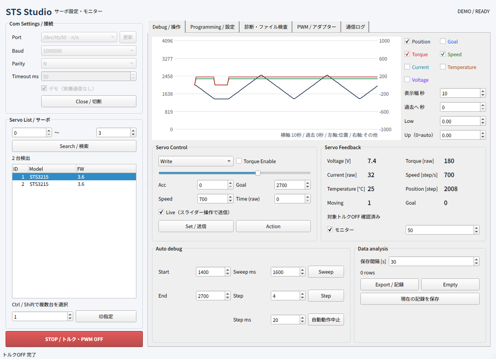
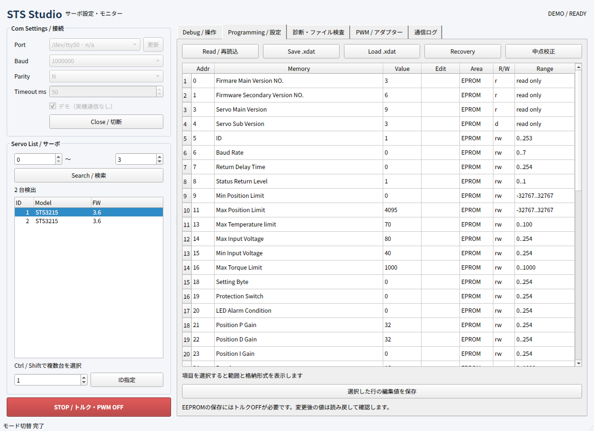

# STS Studio

FEETECH Debug Tool

[English](README.md) · [ダウンロード](https://github.com/kotek-7/sts-studio/releases/latest) · [CLI](docs/CLI.md)

STS Studioは、FEETECH製シリアルバスサーボの設定・操作・監視ツールです。Linuxでも、[秋月電子の説明書](https://akizukidenshi.com/goodsaffix/feetech_digital_servo_20220729.pdf)で紹介されているFEETECHのデバッグソフトのようにサーボを扱いたくて開発しました。

接続したサーボの検索、レジスタ編集、位置・速度指令、フィードバックのグラフ表示、CSV・TXT記録ができます。実機なしで使えるデモモードと、JSONを出力するCLIもあります。



*デモモードの画面。グラフは仮想サーボの応答です。*

## ダウンロードと起動

[Releases](https://github.com/kotek-7/sts-studio/releases/latest)からOSに合うファイルを取得してください。バイナリ配布物にはPythonとQtを同梱しています。

| 環境 | ファイル | 起動方法 |
| --- | --- | --- |
| Ubuntu 24.04、x86_64 | `sts-studio_<version>_amd64.deb` | `sudo apt install ./sts-studio_<version>_amd64.deb`でインストールし、アプリ一覧から起動 |
| Linux、x86_64 | `sts-studio-<version>-linux-x86_64.tar.gz` | 展開して`gui/sts-studio-gui`を実行。Ubuntu 24.04相当のシステムライブラリが必要 |
| Windows 11、x86_64 | `sts-studio-<version>-windows-x86_64.zip` | フォルダー全体を展開し、`gui/sts-studio-gui.exe`を実行 |
| macOS、Apple silicon | `sts-studio-<version>-macos-arm64.zip` | 展開して`STS Studio.app`を起動 |
| macOS、Intel | `sts-studio-<version>-macos-x86_64.zip` | 展開して`STS Studio.app`を起動 |

macOSは14以降を対象にしています。Windows版は未署名、macOS版はDeveloper ID署名・公証をしていません。初回起動、Linuxの依存、チェックサムの確認は[インストール手順](docs/INSTALL.ja.md)を参照してください。

実機なしで試すには「デモ（実機通信なし）」を選び、Open、Searchの順に操作します。仮想サーボを選ぶと設定とフィードバックを確認できます。

## 接続と操作

PortとサーボのBaudを選び、Openで接続してSearchで検索します。初期Baudは115,200です。Ctrl / Shiftで複数台を選択でき、設定は選択IDの先頭、動作指令は選択した全台を対象にします。

接続しただけでは動作指令を送りません。Liveは初期ONで、スライダーを動かすと位置指令を送ります。STOPはトルクOFFを要求し、監視は続けます。Reg Writeの登録指令はSTOPでは消えず、後のActionで実行される可能性があります。自動動作は[操作ガイド](docs/USAGE.ja.md)を確認してから使ってください。

## 設定とファイル



*デモモードの設定画面。*

EEPROMはトルクOFFで編集し、書込後に読み戻して確認します。STSの`.xdat`は40byteの設定領域を保存します。復元時はモデル・FWを照合し、選んだ差分を適用します。監視結果はCSVまたはTXTへ記録できます。

STSを主な対象にしています。SCS/SMSの定義も含みますが、使える操作はモデルとFWのプロファイルによって変わります。ファームウェアはファイル検査のみ対応し、書き込みには対応していません。FEETECH公式の製品ではありません。

## CLI

Ubuntuのdebでは`sts-studio`、展開版では`cli/`内の実行ファイルを使います。

```sh
sts-studio --demo scan
sts-studio --port /dev/ttyUSB0 --baud 1000000 feedback --id 1
```

Windowsのポートは`COM3`、macOSは`/dev/cu.*`などです。結果はJSON、連続監視はJSON Linesで出力します。[CLIの使い方](docs/CLI.md)を参照してください。

## ソースから起動

[uv](https://docs.astral.sh/uv/getting-started/installation/)をインストールし、次を実行します。

```sh
git clone https://github.com/kotek-7/sts-studio.git
cd sts-studio
uv sync --locked
uv run --locked python -m sts_studio --demo
```

Python 3.12を使用します。CLIは`uv run --locked python -m sts_studio cli --demo scan`で実行できます。

## 開発

[開発ガイド](docs/DEVELOPMENT.md) · [設計](docs/DESIGN.md) · [レジスタ表](docs/REGISTERS.md) · [変更履歴](CHANGELOG.md)

`uv run --locked python tools/check.py`で整形・lint・型・仕様書との整合・テストを確認します。不具合は[Issues](https://github.com/kotek-7/sts-studio/issues)へ、バージョン、OS、再現手順と関連するログを添えて報告してください。

## ライセンス

STS Studioは[MITライセンス](LICENSE)です。同梱ライブラリにはそれぞれのライセンスが適用されます。[第三者ライセンス](THIRD_PARTY_NOTICES.md)を参照してください。
