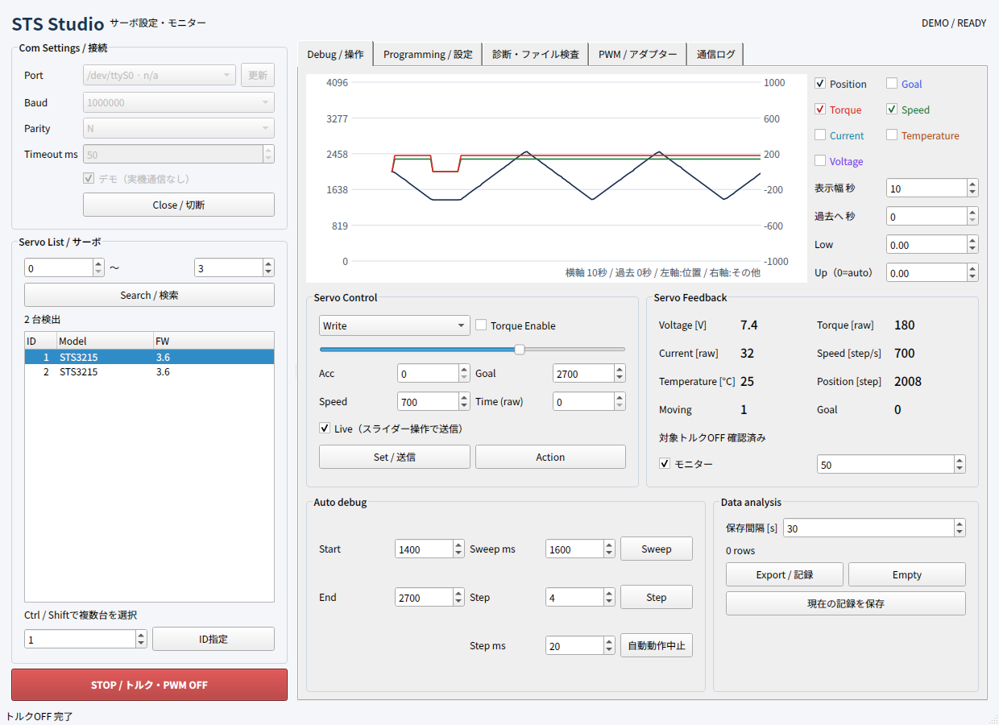
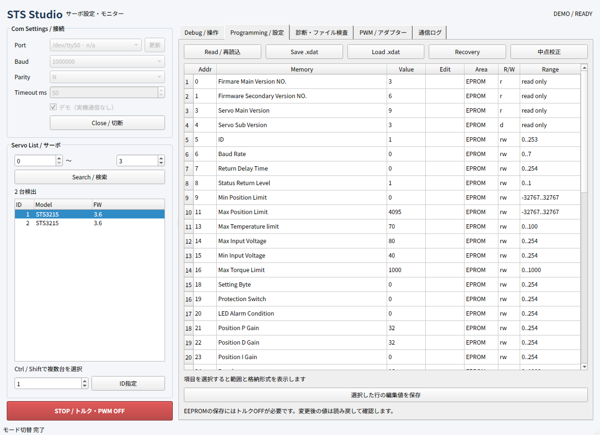

# STS Studio

FEETECH Debug Tool

[日本語](README.ja.md) · [Download](https://github.com/kotek-7/sts-studio/releases/latest) · [CLI](docs/CLI.en.md)

[](https://github.com/kotek-7/sts-studio/actions/workflows/check.yml)
[](LICENSE)

STS Studio configures and monitors FEETECH serial bus servos. It started from wanting a Linux tool for the tasks covered by the FEETECH debugging software in [Akizuki Denshi's servo guide](https://akizukidenshi.com/goodsaffix/feetech_digital_servo_20220729.pdf).

Find connected servos, edit registers, send position and speed commands, and save feedback as CSV or TXT. The desktop app includes plots and a demo mode. A separate CLI returns JSON for scripts.



*Demo mode, using simulated feedback. The interface uses Japanese and English labels.*

## Download and run

Get the package for your system from [Releases](https://github.com/kotek-7/sts-studio/releases/latest). The binary packages include Python and Qt.

| System | File | Start the app |
| --- | --- | --- |
| Ubuntu 24.04, x86_64 | `sts-studio_<version>_amd64.deb` | Install with `sudo apt install ./sts-studio_<version>_amd64.deb`, then open STS Studio from the app menu |
| Linux, x86_64 | `sts-studio-<version>-linux-x86_64.tar.gz` | Extract and run `gui/sts-studio-gui`; requires Ubuntu 24.04 or compatible system libraries |
| Windows 11, x86_64 | `sts-studio-<version>-windows-x86_64.zip` | Extract the entire folder and open `gui/sts-studio-gui.exe` |
| macOS, Apple silicon | `sts-studio-<version>-macos-arm64.zip` | Extract and open `STS Studio.app` |
| macOS, Intel | `sts-studio-<version>-macos-x86_64.zip` | Extract and open `STS Studio.app` |

macOS packages target macOS 14 or later. Windows packages are unsigned; macOS packages are not Developer ID signed or notarized. See [installation and troubleshooting](docs/INSTALL.md) for first-launch instructions, Linux dependencies, CLI paths, and checksum verification.

To explore without hardware, select **デモ（実機通信なし）**, click **Open**, then **Search**. Select a virtual servo to view its registers and feedback.

## Connect a servo

Select the serial port and the servo's baud rate, click **Open**, then **Search**. The default baud rate is 115,200; change it to match the servo. Ctrl/Shift selects multiple servos. Configuration uses the first selected ID; motion commands use the whole selection.

Opening a connection does not send motion commands. Live is enabled by default: moving the slider sends a position command. STOP requests torque OFF and leaves monitoring running. Registered commands remain queued on the servo after STOP and can be executed by a later Action. See the [operation guide](docs/USAGE.md) before using automatic motion.

## Registers and files



*Register editor in demo mode.*

EEPROM edits require torque OFF. Writes are read back for confirmation. STS `.xdat` backups store the 40-byte configuration area; restore checks model and firmware and applies selected differences. Monitoring can record CSV or TXT.

STS is the main target. The catalog also contains SCS/SMS definitions; available operations depend on the model and firmware profile. Firmware files can be inspected, but firmware flashing is not implemented. This is an independent project, not a FEETECH product.

## CLI

The CLI runs without opening the GUI. For an extracted package, use the executable in `cli/`; the Ubuntu deb installs `sts-studio` on PATH.

```sh
sts-studio --demo scan
sts-studio --port /dev/ttyUSB0 --baud 1000000 feedback --id 1
```

On Windows, a port name is usually `COM3`; on macOS it is usually `/dev/cu.*`. Results are JSON, and `watch` emits JSON Lines. See [CLI commands](docs/CLI.en.md).

## Run from source

Install [uv](https://docs.astral.sh/uv/getting-started/installation/), then run:

```sh
git clone https://github.com/kotek-7/sts-studio.git
cd sts-studio
uv sync --locked
uv run --locked python -m sts_studio --demo
```

Source commands work on all three operating systems. Python 3.12 is selected by the project. For a source CLI invocation, use `uv run --locked python -m sts_studio cli --demo scan`.

## Development

[Development guide](docs/DEVELOPMENT.en.md) · [Contributing](CONTRIBUTING.md) · [Changelog](CHANGELOG.md)

Run `uv run --locked python tools/check.py` for formatting, lint, types, specification consistency, and tests. The detailed [design](docs/DESIGN.md) and [register reference](docs/REGISTERS.md) are currently in Japanese.

Report bugs through [GitHub Issues](https://github.com/kotek-7/sts-studio/issues). Include the app version, OS, steps to reproduce, and relevant log output.

## License

STS Studio is licensed under [MIT](LICENSE). Bundled dependencies retain their own licenses; see [third-party notices](THIRD_PARTY_NOTICES.md).
