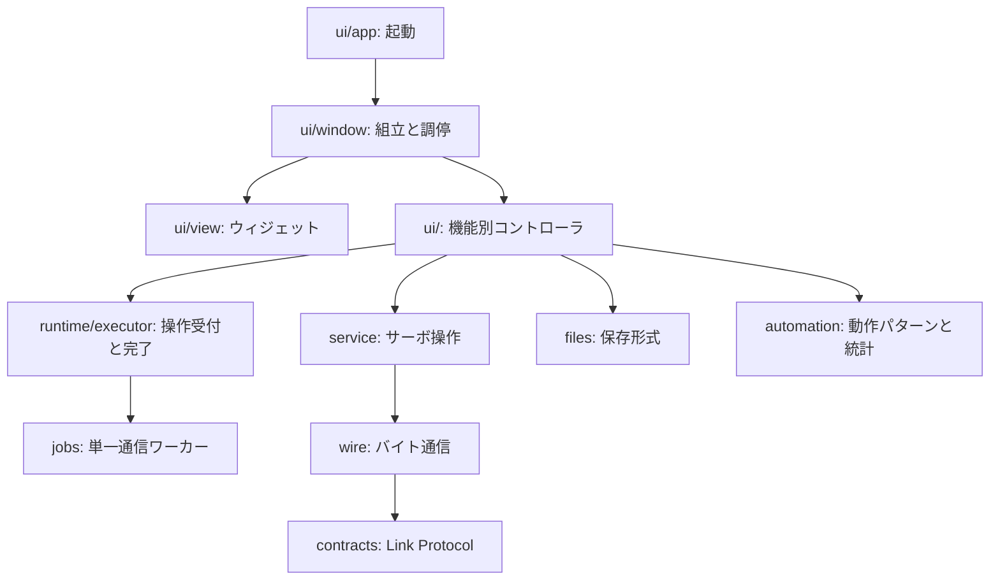

# 開発・アーキテクチャ

## 起動と検査

```sh
uv sync --locked
uv run --locked ./run.sh --demo
uv run --locked python tools/check.py
```

Python 3.12を `.python-version` と `pyproject.toml` で指定し、実際の依存バージョンとハッシュを `uv.lock` で固定します。新規チェックアウトでは `uv sync --locked` を使用します。依存変更は `uv add` / `uv remove` で行い、pyprojectとlockを一緒にコミットします。実行時に不要なRuff・mypy・pytest・pytest-qt・pyserial型定義はdevグループです。

Qtとpyserialは維持しました。ネイティブのウィジェット、USBシリアル、既存の通信仕様を扱うための機能は足りており、今回の問題は状態所有とイベント境界でした。UIフレームワークの全面変更より、標準ライブラリのThreadPoolExecutorと明示的なQtスロットで独自の待機・引数推測処理を減らしています。

## 責務と依存

以下の矢印は実行順ではなく、実行時のコード依存です。featureコントローラはQt画面に依存しますが、通信・ファイル・サーボ操作はQtをimportしません。



| 変更内容 | 主な追加先 |
|---|---|
| ポート・検索・選択 | `ui/connection.py` |
| パラメータ編集・保存・復元 | `ui/programming.py` |
| 動作・停止・自動運転 | `ui/motion.py`、`automation.py` |
| FB表示・記録 | `ui/monitoring.py`、`ui/trend.py`、`files.py` |
| 通信診断・ファイル検査 | `ui/diagnostics.py` |
| アダプター操作 | `ui/pwm.py` |
| 配置・ボタン接続 | `ui/view.py`、`ui/signals.py` |
| 接続中のIDや停止未確認状態 | `runtime/session.py` |
| 実行・待機・完了の契約 | `runtime/executor.py`、`jobs.py` |
| 通信結果の形・リンクの契約 | `contracts.py` |

`Session` が接続・選択・停止確認の正本です。`Service` が検出済みサーボと登録指令の正本です。自動動作と最新手動指令はMotionController、記録はMonitoringController、通信統計はDiagnosticsControllerが所有します。Windowへ機能処理を戻さず、所属コントローラを変更します。

機能間の連携はWindow経由の明示的な参照で行います。コントローラのWindow型参照はTYPE_CHECKING内だけに置き、実行時の循環importを避けます。汎用イベントバスやDIコンテナは導入していません。

## 型・整形・テスト

```sh
uv run --locked ruff format src tests tools
uv run --locked ruff check src tests tools
uv run --locked mypy
uv run --locked python tools/render_spec.py
QT_QPA_PLATFORM=offscreen uv run --locked pytest -q
```

mypyは全ソースを対象に、未注釈の関数本体も検査します。通信、catalog、Service、Worker、runtime、純粋な動作モデル、Qtスロット境界では未注釈の関数定義・呼出を禁止し、Anyの戻り値も検出します。GUIの一部コールバックとJSONメタデータには動的な型が残っており、全コードがstrict型付け済みという意味ではありません。通信結果はTypedDict、接続はdataclass、最新指令はdataclassのunion、自動動作・記録はTypedDictで表現します。

既存のunittest資産はpytestから実行します。新しいGUIシナリオはpytest-qtでボタンを実際にクリックし、Qtイベント中の例外も検出します。実機の代わりにVirtualLinkとLinux PTYを使います。通信の仕様を変える場合はパケットの契約テストも変更します。

## GitとCI

```sh
git config core.hooksPath .githooks
git diff --check
```

`main` に基準版と再構成の変更を別コミットで保存しています。ローカルのpre-commitフックは整形・lint・型・生成仕様書を検査し、ファイルを自動修正しません。テストを含めた全検査は `tools/check.py`。GitHub Actionsも同じコマンドを使用します。リモートへのpushや公開は行っていません。

`.venv`、キャッシュ、`work/`、`dist/` はGit管理外です。生成仕様書はレビューできるよう追跡し、元JSON・ソースとの一致を検査します。依存lockは必ず追跡します。

## 配布

`uv run --locked python tools/package.py` はバージョンをpyprojectから読み、debとソースアーカイブを生成します。debはUbuntuのシステムPython・Qt・pyserialで起動し、開発用venvをコピーしません。ソースアーカイブにはuv.lock・開発設定・テストを含めます。

参考: [uvプロジェクト管理](https://docs.astral.sh/uv/guides/projects/)、[Ruff設定](https://docs.astral.sh/ruff/configuration/)、[mypy設定](https://mypy.readthedocs.io/en/stable/config_file.html)、[uvとGitHub Actions](https://docs.astral.sh/uv/guides/integration/github/)。
